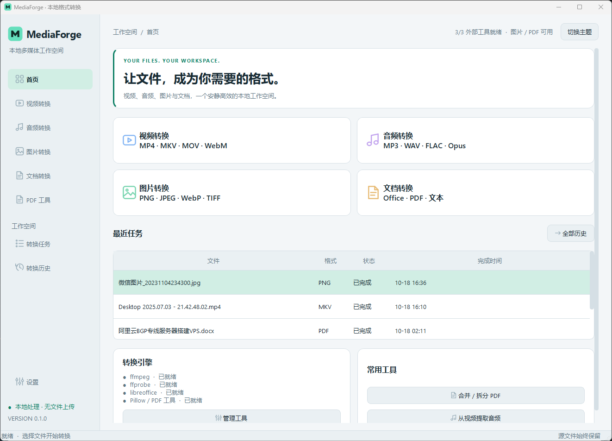

<div align="center">
  
  <h1>MediaForge</h1>
  <p><strong>让文件，成为你需要的格式。</strong></p>
  <p>完全本地运行的 PySide6 多媒体转换工作台<br>
  视频 · 音频 · 图片 · 文档 · PDF，一个窗口完成。</p>

  <p>
    <a href="https://www.python.org/"></a>
    <a href="https://doc.qt.io/qtforpython-6/"></a>
    
    
    <a href="LICENSE"></a>
  </p>

  <p>
    <a href="#界面预览">界面预览</a> ·
    <a href="#核心能力">核心能力</a> ·
    <a href="#快速开始">快速开始</a> ·
    <a href="#外部工具">外部工具</a> ·
    <a href="#安全与隐私">安全与隐私</a>
  </p>
</div>

> [!IMPORTANT]
> **v0.1.0 · 第一阶段基础版。** 已实现真实转换，面向 Windows 11，并保持 Linux 可移植结构。文件始终在本机处理，不上传、不发送遥测，也不包含云端转换接口。
>
> 仓库目前仅发布源码、测试与构建脚本，**尚未上传 GitHub Release 或便携程序包**。文中 `dist`、`release`、`.tools` 和测试产物路径均为本地构建 / 验证目录，不包含在仓库中。

## 界面预览

<p align="center">
  <picture>
    <source media="(prefers-color-scheme: dark)" srcset="docs/screenshots/home-dark.png">
    <source media="(prefers-color-scheme: light)" srcset="docs/screenshots/home-light.png">
    
  </picture>
</p>

<p align="center">
  <sub>首页 · 自动适配系统深浅色主题 · <a href="docs/screenshots/home-dark.png">深色原图</a> / <a href="docs/screenshots/home-light.png">浅色原图</a></sub>
</p>

## 为什么是 MediaForge

| 本地优先 | 真实可靠 |
|:---|:---|
| **文件不出本机**<br>转换、日志与历史都留在本机。不访问云端转换服务，不发送遥测，也没有上传等待。 | **真实引擎，真实进度**<br>FFmpeg / FFprobe、LibreOffice 与 Pillow 实际执行；只有引擎时间戳、已处理帧或页面才产生百分比。 |
| **五类文件，一个工作台**<br>视频、音频、图片、文档与 PDF 共用任务队列、输出目录和重名策略，默认并发 1、最多 3。 | **输出经过验证**<br>文件存在、非空并通过格式验证后才发布；多输出失败会回滚，覆盖模式保留原输出备份。 |

## 核心能力

| 类别 | 输出与主要选项 | 引擎 |
|:---:|---|---|
| 🎬 **视频** | MP4 / MKV / MOV / AVI / WebM / M4V；H.264 / H.265 / VP9 / MPEG-4 / 流复制、分辨率、帧率、码率、音轨、字幕 | FFmpeg + FFprobe |
| 🎵 **音频** | MP3 / WAV / FLAC / AAC / M4A / OGG / Opus / AIFF；采样率、声道、码率、音量、裁剪、视频音轨提取 | FFmpeg + FFprobe |
| 🖼️ **图片** | PNG / JPEG / WebP / BMP / TIFF / GIF；质量、尺寸、比例、旋转、透明背景、EXIF、多帧 | Pillow |
| 📄 **文档** | Writer、Calc、Impress 各自家族内支持格式互转及 PDF 导出；TXT→HTML / UTF-8 TXT 有独立本地路径 | LibreOffice / 本地文本转换 |
| 📑 **PDF** | 合并、每页拆分、按页提取、页面转 PNG/JPEG、多图合并 PDF | pypdf + PyMuPDF |

视频编码器从当前 FFmpeg 构建实际检测。默认 MP4/MOV/MKV/M4V 使用 H.264，WebM 使用 VP9，AVI 使用 MPEG-4；不兼容的编码、字幕和容器组合会在启动编码前报错。流复制不与缩放、调音或精确裁剪混用。

## 快速开始

| 项目 | 要求 |
|---|---|
| 系统 | Windows 11 x64；Linux 保留可移植结构，尚未完成 Debian 真机验证 |
| Python | 3.12 或更高（本次开发验证 3.14.5） |
| 外部工具 | FFmpeg / FFprobe、LibreOffice；图片与 PDF 转换另用 Pillow、PyMuPDF、pypdf 等 Python 依赖 |

### 从源码运行（Windows）

```powershell
git clone https://github.com/sweetljk/MediaForge.git
cd MediaForge
python -m venv .venv
.\.venv\Scripts\python.exe -m pip install -e ".[dev]"
.\run.ps1
```

也可运行 `.\setup.ps1` 自动创建虚拟环境并安装依赖。若组织的 PowerShell 策略禁止脚本，可直接使用上面的 Python 命令，不必修改系统策略。

`run.ps1` 使用 `.venv` 启动源码入口。安装依赖后，也可双击 `Start MediaForge.vbs`：若已构建 `dist\MediaForge\MediaForge.exe` 会优先启动它，否则回退到源码入口。

本次 Windows 实测的精确依赖版本见 [requirements-tested.txt](requirements-tested.txt)，可用于重建同版本环境；日常安装使用 [pyproject.toml](pyproject.toml) 的兼容范围。

### 完整便携版（发送给其他 Windows 电脑）

完整便携版需要本地构建，仓库暂不提供现成 ZIP。准备好 `.tools` 中的 FFmpeg / FFprobe 与 LibreOffice 后运行：

```powershell
.\build-portable.ps1
```

生成 `release/MediaForge-0.1.0-windows-x64-portable.zip`。解压整个压缩包，打开 `MediaForge` 文件夹，双击 **MediaForge.exe**；无需 Python、VBS 启动器、引擎安装或系统环境变量配置。

便携版把 FFmpeg / FFprobe 和 LibreOffice 放在 EXE 同目录的 `.tools` 中，并附带运行库；移动整个文件夹后仍会自动检测。必须保留 `_internal` 和 `.tools`，不能只发送 EXE。设置与历史仍保存在当前用户的 LocalAppData，不会改为随包保存。曾手动指定的工具路径优先于自动检测；旧路径失效时可在设置中清空后重新检测。

完整版目前面向 Windows 11 x64。程序已在开发机上以空工具配置、清除引擎环境变量及精简 PATH 验证；项目维护者另已反馈在新电脑上解压后可直接使用，但这不代表所有 Windows 配置均已测试。

### Debian / Linux

```sh
sudo apt install python3-venv ffmpeg libreoffice libxcb-cursor0 libegl1
# 确保所选 python3 为 3.12 或更高；较旧 Debian 应另行安装兼容 Python。
python3 -m venv .venv
.venv/bin/python -m pip install -e '.[dev]'
sh run.sh
```

Linux 运行需要图形会话。当前交付在 Windows 实测，尚未声称已完成 Debian 真机验证。

## 使用方式

1. 从侧栏选择视频、音频、图片、文档或 PDF 工具。
2. 添加文件、选择文件夹，或拖放文件到窗口；文件信息在后台读取。
3. 选择输出格式、输出目录和转换参数。可为单个文件单独设置参数。
4. 加入任务队列并开始。队列支持取消、重试、移除、打开输出目录和查看日志。
5. 在“设置”配置工具路径、目录、主题、默认参数、并发数和重名策略。

默认并发 1，最多 3。只有真实的引擎时间戳、已处理帧或页面才产生百分比；LibreOffice 无百分比接口，显示正在处理。100% 表示输出验证和保存完成。第一版不提供暂停；取消后可重试。

## 外部工具

程序不会自动下载安装系统工具。查找顺序为 **设置路径 → 环境变量 → 随包 `.tools` → 系统 PATH → 常见安装位置**。打包程序以 EXE 所在目录定位 `.tools`，也兼容 `dist/MediaForge` 与顶层 `.tools` 的原目录结构，不依赖当前工作目录。某个工具缺失时，其他类别仍能使用。

| 工具 | 用途 | 获取与配置 |
|:---|:---|:---|
| **FFmpeg / FFprobe** | 视频、音频转换与媒体探测 | 从 [FFmpeg 官方下载页](https://ffmpeg.org/download.html) 选择平台构建；Windows 可参考 [Gyan 构建](https://www.gyan.dev/ffmpeg/builds/)。解压后分别指定 `bin/ffmpeg.exe` 和 `bin/ffprobe.exe`。FFprobe 也可从配置的 FFmpeg 同目录查找。 |
| **LibreOffice** | Office 文档转换与 PDF 导出 | 从 [LibreOffice 官网](https://www.libreoffice.org/download/download-libreoffice/) 安装。Windows 常见位置为 `C:\Program Files\LibreOffice\program\soffice.com` 或 `soffice.exe`，Linux 通常为 `/usr/bin/libreoffice`。 |
| **ImageMagick** | 检测、配置与版本查看 | 当前转换器使用 Pillow，尚未开放 ImageMagick 的额外解码格式；检测成功不等于支持这些格式。 |

也可使用 `MEDIAFORGE_FFMPEG`、`MEDIAFORGE_FFPROBE`、`MEDIAFORGE_LIBREOFFICE` 环境变量指定路径。工作区的 `.tools` 不进入普通构建；完整便携构建会复制实际运行文件与原许可证，排除安装包和下载缓存。

## 安全与隐私

- **原始文件只读**：不改写输入；即使选择覆盖输出，也拒绝覆盖任何输入路径。
- **重名策略可控**：默认自动加 `(1)`、`(2)`；也可选择跳过，或经明确确认后覆盖已有输出。
- **独立暂存，验证后发布**：每项任务使用独立暂存目录，确认文件存在、非空并完成相应格式验证后才发布。多输出发布失败会回滚；覆盖模式会保存原输出备份。
- **进程隔离**：图片、PDF、文档在独立工作进程处理；取消和超时会终止进程树。FFmpeg 使用实际进度协议和可终止进程。避免 PyMuPDF 在共享进程内并发访问。
- **临时文件与磁盘**：每项任务结束清理其创建的临时目录；被系统占用时保留并提示，不扫描删除用户目录。崩溃遗留的 `mf-<任务ID>-*` 目录可在确认无任务运行后人工清理。输出盘和临时盘会做空间预检，磁盘写满、权限错误和文件损坏会显示失败原因。
- **日志与数据目录**：本地任务日志可能包含文件路径和引擎错误，但不会主动记录文档正文，也不会上传日志。设置和历史默认保存在 `%LOCALAPPDATA%\MediaForge`（Linux 为 `~/.local/share/MediaForge`）；可用 `MEDIAFORGE_DATA_DIR` 隔离测试数据。历史使用 SQLite，任务队列重启后不会自动恢复执行。
- **外部程序调用**：所有外部程序仅由 `engines.process` 以参数数组、`shell=False` 执行。LibreOffice 使用独立用户配置、最高宏安全设置与禁用加载时更新；请仅处理可信来源文档。FFmpeg 限制本地 file/pipe 协议。

## 明确限制

- Office 文档转换受 LibreOffice 版本、过滤器和字体影响，不保证无损排版。文档家族间不任意互转。PDF→可编辑 Word、OCR、扫描件识别未开放。
- 动画选择“第一帧”会丢弃后续帧；保留多帧需目标支持。JPEG/BMP 不保留透明度。GIF 颜色受限。EXIF/ICC 尽可能保存，不保证所有元数据跨格式完整。
- 无损格式不能恢复已被有损压缩丢失的信息；有损再次编码可能降低质量。
- 默认只转换首个视频流；音轨可全选或按从 0 开始的索引指定。图形字幕不能转文字；某些字幕样式在转码时会改变。硬件编码和 HDR/色彩管理的高级工作流尚未开放。
- PDF 页码从 1 开始，例如 `1-3,5,8-10`。加密文件需先在原软件解密；PDF 表单、签名和复杂结构在页面重组后应重新检查。图片转 PDF 的多帧输入只取第一帧。
- 设置资源上限：图片 8000 万像素、多帧累计 1 亿像素，PDF 10000 页、单页渲染 4000 万像素、36–600 DPI；以避免异常输入耗尽资源。
- 不访问云转换服务；外部工具可能具有自己的行为。LibreOffice 使用独立用户配置、最高宏安全设置与禁用加载时更新；请仅处理可信来源文档。FFmpeg 限制本地 file/pipe 协议。

## 测试与打包

```powershell
.\.venv\Scripts\python.exe -m pytest -q
.\.venv\Scripts\python.exe -m pytest -m integration -q
.\build.ps1
# 完整便携包（须先准备 .tools 中的工具）：
.\build-portable.ps1
```

Windows 产物为 `dist\MediaForge\MediaForge.exe`，需分发整个同名目录。构建不捆绑 FFmpeg、LibreOffice 或 ImageMagick。Windows 可执行程序需在 Windows 构建；Linux 使用对应系统构建。

`build-portable.ps1` 另行创建 `release/MediaForge` 和完整便携 ZIP，包含 FFmpeg / FFprobe、LibreOffice 及其运行库，自动执行打包程序的 6 条真实转换验证，并生成 ZIP 的 SHA256 校验文件。为避免覆盖正在使用的发布文件，重新构建前需先把现有发布目录及 ZIP 移走。普通 `dist` 产物与 `release` 完整版相互独立。

自动化样例全在临时目录生成，不读取个人文件。实际验证范围与环境记录见 [TEST_REPORT.md](TEST_REPORT.md)，开发结构和扩展方式见 [DEVELOPMENT.md](DEVELOPMENT.md)。

## 项目文档

- [开发结构与扩展方式](DEVELOPMENT.md)
- [测试报告](TEST_REPORT.md)
- [第三方许可证](THIRD_PARTY_NOTICES.md)
- [工具来源与版本](TOOLS_PROVENANCE.md)

## 许可证

MediaForge 项目代码采用 **GNU AGPL v3.0（AGPL-3.0-only）**，见 [LICENSE](LICENSE)。第三方组件保留各自许可证，见 [THIRD_PARTY_NOTICES.md](THIRD_PARTY_NOTICES.md)。

分发前请特别检查 PyMuPDF 的 AGPL / 商业双许可，以及具体 FFmpeg 构建的许可。

<div align="center">
  <sub>本地处理 · 不上传 · 源文件始终保留</sub>
</div>
